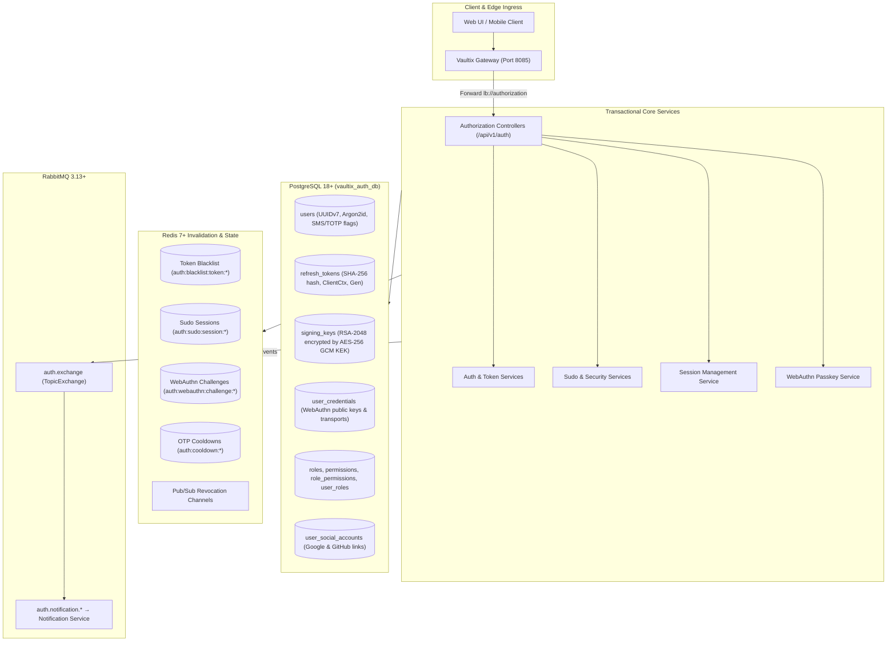

# Vaultix Authorization Service

[](https://openjdk.org/)
[](https://spring.io/projects/spring-boot)
[](https://spring.io/projects/spring-cloud)
[](https://openjdk.org/jeps/444)
[](https://www.w3.org/TR/webauthn-3/)
[](https://www.postgresql.org/)
[](https://redis.io/)
[](https://www.rabbitmq.com/)
[](https://opensource.org/licenses/Apache-2.0)

The mission-critical, enterprise Authentication, Identity & Access Management (IAM) microservice for the **Vaultix** distributed platform. Features OAuth2/OIDC identity federation (Google & GitHub), W3C WebAuthn Level 3 passkeys, RFC 6238 TOTP, SMS multi-factor authentication, emergency recovery codes, dynamic asymmetric RSA-2048 signing key rotation with AES-256 GCM KEK encryption, refresh token rotation with reuse detection, distributed session management, real-time Redis cache invalidation, granular hierarchical RBAC governance, and step-up Sudo mode elevation.

---

## Service Overview

| Attribute | Specification |
| :--- | :--- |
| **Port** | `8082` (Context path: `/api/v1/auth`) |
| **Gateway Route** | `http://localhost:8085/api/v1/auth/**` &rarr; `lb://authorization` |
| **Framework** | Spring Boot `4.1.2` / Spring Cloud `2025.1.4` / Spring Security 7.x / Nimbus JOSE |
| **Runtime** | Java 27 (OpenJDK / Amazon Corretto 27) with Virtual Threads enabled |
| **Database** | PostgreSQL 18+ (`vaultix_auth_db`) with Flyway migrations (`V1` &rarr; `V9`) |
| **Distributed Cache & Pub/Sub** | Redis 7+ (`auth:*` keyspace, real-time revocation broadcast) |
| **Event Messaging** | RabbitMQ (`auth.exchange`, topic routing for async notification events) |
| **Discovery** | Eureka Client (`http://localhost:8761/eureka/`) |

---

## Documentation Index

Detailed architectural blueprints, cryptographic primitives, and complete endpoint specifications are maintained in the [`docs/`](docs/) directory:

| Document | Description |
| :--- | :--- |
| 📖 [**Core Security Architecture**](docs/ARCHITECTURE.md) | In-depth breakdown of the 16 security subsystems: dynamic RSA-2048 key rotation, AES-256 GCM KEK encryption, refresh token rotation with reuse detection, Redis Pub/Sub revocation, hierarchical RBAC governance, ShedLock distributed maintenance, TOTP, WebAuthn Passkeys, Social Identity Federation (Google OIDC / GitHub OAuth2), SMS MFA, Sudo Mode Elevation, Distributed Session Management, and Admin MFA Reset. |
| 📡 [**REST API Reference**](docs/API.md) | Complete specification of all `/api/v1/auth` endpoints: Public auth (login, register, OAuth2/OIDC, passkeys, JWKS), Authenticated Account & Profile, Multi-Factor Authentication (TOTP, SMS, Recovery Codes), Connected Social Accounts, Active Session Management (`/sessions`), Sudo Elevation (`/sudo`), and Admin Management (Users, Roles, Permissions, Signing Keys). |

---

## Architectural Data Flow



---

## Directory Structure

```text
authorization/
├── pom.xml                                    /* Spring Boot 4.1.2, Spring Cloud 2025.1.4, Java 27 */
├── README.md                                  /* Service runbook and overview */
├── .env.example                               /* Template environment configuration */
├── docs/
│   ├── ARCHITECTURE.md                        /* Comprehensive security architecture */
│   └── API.md                                 /* Complete REST API endpoint reference */
└── src/main/
    ├── java/com/vaultix/authorization/
    │   ├── bootstrap/                         /* Initial data seeder (Roles, Permissions, Super Admin) */
    │   ├── config/                            /* SecurityConfig, JwtDecoderConfig, RabbitConfig, Redis */
    │   ├── controller/
    │   │   ├── AccountController.java         /* Profile, password, username, email/phone verification */
    │   │   ├── AuthController.java            /* Session logout, logout-other, logout-all */
    │   │   ├── JwksController.java            /* Public RFC 7517 JWK Set endpoint */
    │   │   ├── MfaRecoveryCodeController.java /* Recovery codes count & regeneration */
    │   │   ├── PasskeyController.java         /* WebAuthn passkey registration & credential management */
    │   │   ├── SessionController.java         /* Active sessions pagination, inspection & revocation */
    │   │   ├── SmsMfaController.java          /* SMS MFA setup, OTP verification, activation & disable */
    │   │   ├── SocialAccountController.java   /* Social account listing, linking & unlinking */
    │   │   ├── SudoController.java            /* Step-up Sudo mode verification, passkey & status */
    │   │   ├── TotpController.java            /* RFC 6238 TOTP setup, QR URI generation & activation */
    │   │   ├── admin/
    │   │   │   ├── AdminPermissionController.java /* Permission listing & administrative disablement */
    │   │   │   ├── AdminRoleController.java       /* Hierarchical role CRUD, search & permissions */
    │   │   │   ├── AdminSigningKeyController.java /* Key listing, search, manual rotation & revocation */
    │   │   │   └── AdminUserController.java       /* User CRUD, search, disable/enable, delete & reset-mfa */
    │   │   └── pub/
    │   │       ├── EmailRevertController.java     /* 7-day secure email revert token execution */
    │   │       ├── GitHubAuthController.java      /* GitHub OAuth2 code-to-token exchange & auto-provision */
    │   │       ├── GoogleAuthController.java      /* Google OIDC ID token validation & auto-provision */
    │   │       ├── PasswordResetController.java   /* Password reset OTP request & confirmation */
    │   │       └── PublicAuthController.java      /* Login, register, MFA challenge verification, refresh */
    │   ├── dto/                               /* Validated request & response records */
    │   ├── entity/                            /* JPA entities (User, RefreshToken, SigningKey, Role, etc.) */
    │   ├── exception/                         /* Domain exceptions (AuthException, TokenExpiredException) */
    │   ├── repository/                        /* Spring Data JPA repositories with custom queries */
    │   ├── scheduler/                         /* ShedLock schedulers (Signing keys, tokens, role/user cleanup) */
    │   ├── security/                          /* AuthCookieHelper, CustomUserDetails, WebAuthn components */
    │   ├── service/                           /* Transactional business logic & cryptographic operations */
    │   ├── specification/                     /* Spring Data JPA Criteria specifications for search */
    │   └── validation/                        /* Custom Bean Validation annotations & validators */
    └── resources/
        ├── application.yaml                   /* Virtual threads, DB, Redis, RabbitMQ, JWT & KEK settings */
        └── db/migration/
            ├── V1__create_rbac_schema.sql
            ├── V2__create_users_schema.sql
            ├── V3__create_refresh_tokens_schema.sql
            ├── V4__create_signing_keys_schema.sql
            ├── V5__create_totp_schema.sql
            ├── V6__create_recovery_codes_schema.sql
            ├── V7__create_passkeys_schema.sql
            ├── V8__add_sms_mfa_to_users.sql
            └── V9__create_social_accounts_schema.sql
```

---

## Configuration Reference (`application.yaml`)

| Environment Variable | Default Value | Description |
| :--- | :--- | :--- |
| `PORT` | `8082` | HTTP listen port |
| `SPRING_DATASOURCE_URL` | `jdbc:postgresql://localhost:5432/vaultix_auth_db` | PostgreSQL JDBC connection URL |
| `SPRING_DATA_REDIS_HOST` | `localhost` | Redis server host for caches, blacklist, and pub/sub |
| `SPRING_RABBITMQ_HOST` | `localhost` | RabbitMQ broker host for notification events |
| `VAULTIX_SECURITY_KEK_MASTER_KEY` | `3xhw5...` | Base64-encoded 256-bit Key Encryption Key (KEK) |
| `VAULTIX_JWT_ISSUER` | `https://auth.vaultix.com` | JWT `iss` claim matching resource server decoders |
| `VAULTIX_JWT_ACCESS_TOKEN_EXPIRATION` | `5m` | Lifetime of signed JWT access tokens |
| `VAULTIX_JWT_REFRESH_TOKEN_EXPIRATION` | `7d` | Lifetime of rotating refresh token sessions |
| `VAULTIX_PASSKEY_RP_ID` | `localhost` | FIDO2 / WebAuthn Relying Party identifier |
| `VAULTIX_PASSKEY_RP_NAME` | `Vaultix` | Display name for the WebAuthn Relying Party |
| `VAULTIX_PASSKEY_ALLOWED_ORIGINS` | `http://localhost:3000,http://localhost:5173` | Trusted origins for WebAuthn passkey ceremonies |
| `VAULTIX_FRONTEND_BASE_URL` | `http://localhost:3000` | Frontend web URL for email verification links and reverts |
| `VAULTIX_GOOGLE_CLIENT_ID` | &mdash; | Google Cloud OAuth2 Client ID for ID token verification |
| `VAULTIX_GITHUB_CLIENT_ID` | &mdash; | GitHub OAuth2 Application Client ID |
| `VAULTIX_GITHUB_CLIENT_SECRET` | &mdash; | GitHub OAuth2 Application Client Secret |
| `VAULTIX_GITHUB_REDIRECT_URI` | `http://localhost:3000/auth/callback/github` | Registered GitHub OAuth2 callback URL |
| `VAULTIX_RABBITMQ_AUTH_EXCHANGE` | `auth.exchange` | RabbitMQ topic exchange for security alerts and notifications |

---

## Quickstart & Local Execution

### 1. Prerequisites
- **Java 27** (OpenJDK / Amazon Corretto 27)
- **PostgreSQL 18+**, **Redis 7+**, and **RabbitMQ 3.13+** running via `docker compose up -d` in `infra/`
- **Database initialized**: Ensure `postgres/init-auth-db.sql` and `redis/init-auth-acl.txt` are applied (see `infra/README.md`)
- **Eureka Server** running on `http://localhost:8761`

### 2. Build
```powershell
.\mvnw.cmd clean package
```

### 3. Run
```powershell
.\mvnw.cmd spring-boot:run
```

Once running, the service registers with Eureka as `AUTHORIZATION` and handles requests routed through the API Gateway at `http://localhost:8085/api/v1/auth`.

---

## Detailed Documentation

For comprehensive technical guides, cryptographic primitives, and complete API reference documentation:

* 👉 [**Core Security Architecture (docs/ARCHITECTURE.md)**](docs/ARCHITECTURE.md)
* 👉 [**REST API Reference (docs/API.md)**](docs/API.md)
