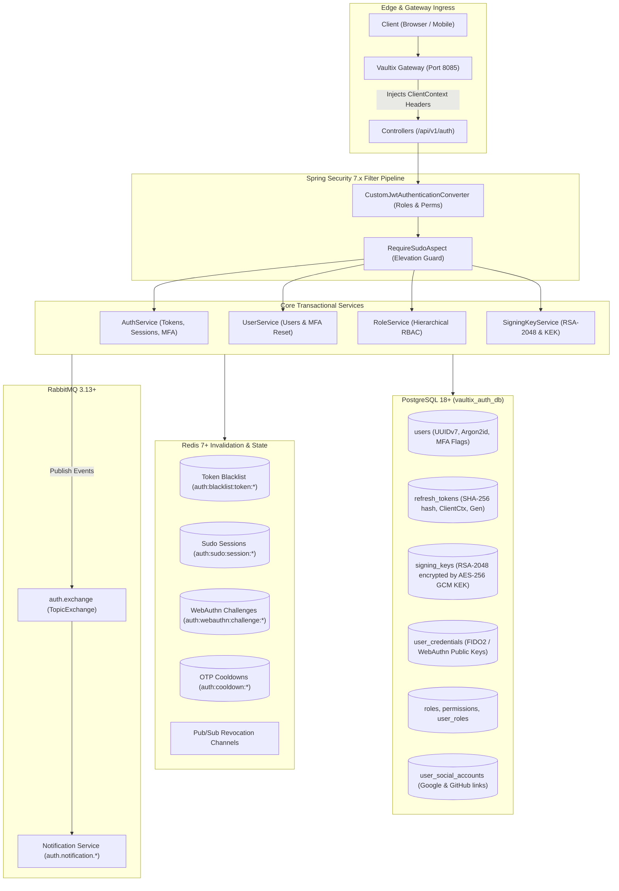

# Vaultix Authorization - Core Security Architecture

This document provides a comprehensive technical breakdown of the 16 security subsystems, cryptographic primitives, distributed caching engines, and lifecycle management within the **Vaultix Authorization Service**.

---

## Architectural Data Flow

---

## 1. Dynamic Asymmetric Signing Keys (RSA-2048)
- Active signing keys are generated as RSA-2048 key pairs and stored in PostgreSQL (`signing_keys` table).
- **KEK Envelope Encryption**: Private keys are encrypted at rest using authenticated **AES-256 GCM** with the platform Key Encryption Key (`VAULTIX_SECURITY_KEK_MASTER_KEY`).
- **Distributed Caching**: Public keys are cached locally with **Caffeine** and synchronized across microservices via **Redis Pub/Sub** (`auth:signing-key:revocation`).
- **Public JWKS**: Exposes `GET /api/v1/auth/.well-known/jwks.json` adhering to RFC 7517.
- **Automated Lifecycle**: Scheduled daily rotation via `SigningKeyScheduler` with configurable retirement retention.

---

## 2. JWT Access Tokens
- Signed with the active RSA-2048 private key via Nimbus JOSE.
- **Claims Schema**:
  - `iss`: Issuer URL (`https://auth.vaultix.com`)
  - `sub`: User UUID
  - `jti`: Unique Token ID (UUIDv7)
  - `sid`: Session ID (corresponds to active Refresh Token JTI)
  - `token_type`: `"access"`
  - `roles_permissions`: Map of active role names to arrays of granted permission strings
  - `iat`: Issued-at timestamp
  - `exp`: Expiration timestamp (5-minute default)
- Validated at the gateway and resource servers via `CommonJwtDecoderFactory` and `SecurityUtil`.

---

## 3. Refresh Token Rotation & Session Tracking
- Stored as a **SHA-256 hash** in PostgreSQL (`refresh_tokens` table) to prevent plaintext exposure upon database breach.
- **Client Context Binding**: Every session persists client `ipAddress`, `deviceInfo` (browser and OS summary up to 256 chars), and `locationInfo`.
- **Generation Tracking (`gen`) & Reuse Detection**: Tokens carry an incrementing generation counter. Presenting a revoked or previously rotated token instantly invalidates the entire session family, mitigating token theft attacks.
- **Cookie Security**: Transmitted as an **`HttpOnly`**, **`SameSite=Strict`** cookie restricted to the `/api/v1/auth/public/refresh` path via `AuthCookieHelper`.

---

## 4. Real-Time Distributed Revocation Engine
- **Disabled Roles & Permissions**: When an administrator disables a role or permission, the entity status is persisted in Redis hashes (`auth:roles:revocations`, `auth:permissions:revocations`) with an explicit TTL matching token lifetime.
- **Transactional Synchronization**: Redis invalidation broadcast occurs strictly inside `TransactionSynchronization.afterCommit()` to ensure downstream instances only evict after database commit.
- **Token Blacklisting**: JTI blacklist in Redis (`auth:blacklist:token:<jti>`) rejects revoked tokens instantly during the `JwtBlacklistValidator` evaluation phase before controller execution.

---

## 5. Hierarchical RBAC & Privilege Protection
- **Role Hierarchy**: Roles maintain a numeric `level` (lower numeric value = higher privilege).
- **Role Governance**: Administrators cannot create, modify, enable, or disable roles with a privilege level equal to or higher than their own active role level (`level <= actorHighestLevel`). Permissions assigned to a role must already be possessed by the actor.
- **User Governance**: Administrators cannot provision or assign roles with a privilege level equal to or higher than their own (`level <= actorHighestLevel`). Administrators cannot edit or modify users whose highest role (active or disabled) is equal to or more privileged than the actor (`targetUserHighestLevel <= actorHighestLevel`).
- **Batch Error Aggregation**: Missing, disabled, and level-violating roles or permissions are collected and reported as complete sets at once rather than failing one by one.
- **Session Revocation on Privilege Change**: Modifying a user's roles automatically revokes all refresh token sessions in PostgreSQL and schedules JTI blacklisting in Redis after transaction commit via `TokenService.revokeAllUserTokens`.
- **Change Detection**: Role and user updates evaluate whether any attributes or roles actually changed. If identical, database updates, audit timestamp updates (`updated_at`, `updated_by`), and token revocations are skipped.

---

## 6. Centralized Error Handling & Spring 6.1+ Method Validation
- **`GlobalExceptionHandler`**: Inherits `BaseGlobalExceptionHandler` from `common`, returning standard `ApiResponse.error(...)` envelopes across all endpoints.
- **Native Method Validation**: Utilizes Spring MVC 6.1+ native `HandlerMethodValidationException` for request parameter constraints (e.g. cookie length limits) without requiring class-level `@Validated` proxies on controllers.
- **Security Leak Prevention**: Masks internal service exceptions (`InternalAuthenticationServiceException`) as generic `"Authentication failed"` to prevent leaking database or connection details to clients.

---

## 7. Event-Driven Messaging Architecture (RabbitMQ)
- Declares **`auth.exchange`** (`TopicExchange`) for cross-service asynchronous event dispatch.
- Downstream notification services subscribe using the wildcard pattern **`auth.notification.*`** without coupling to internal authorization logic.
- Supported routing keys:
  - `auth.notification.welcome`: Dispatched upon user registration (`/public/register`).
  - `auth.notification.password-reset`: Dispatched when requesting password reset (`/public/password-reset/request`) with a cryptographically secure 6-digit OTP.
  - `auth.notification.password-changed`: Dispatched when an authenticated user updates their password (`/password/change`).
  - `auth.notification.email-verification`: Dispatched when requesting email verification OTP with 60s Redis cooldown.
  - `auth.notification.email-changed`: Dispatched upon confirming an email change with a 7-day secure revert token link sent to the old address.
  - `auth.notification.email-reverted`: Dispatched when an email address is reverted via secure token (`/public/email/revert`).
  - `auth.notification.phone-verification`: Dispatched when requesting SMS phone verification OTP with 60s Redis cooldown.
  - `auth.notification.phone-changed`: Dispatched upon confirming a phone number update.
  - `auth.notification.mfa-enabled`: Dispatched when TOTP or SMS two-factor authentication is activated.
  - `auth.notification.mfa-disabled`: Dispatched when two-factor authentication is disabled (or reset by admin).
  - `auth.notification.recovery-code-used`: Dispatched when an emergency recovery code is burned to sign in.
  - `auth.notification.recovery-codes-regenerated`: Dispatched when emergency recovery codes are regenerated.
  - `auth.notification.passkey-added`: Dispatched when a new WebAuthn passkey credential is registered.
  - `auth.notification.passkey-removed`: Dispatched when a WebAuthn passkey is deleted.
  - `auth.notification.social-account-linked`: Dispatched when a Google or GitHub account is linked to the user.
  - `auth.notification.social-account-unlinked`: Dispatched when a Google or GitHub account is unlinked.

---

## 8. Platform-Wide Snake Case JSON (`SNAKE_CASE`)
- Enforces `spring.jackson.property-naming-strategy: SNAKE_CASE` across all DTOs and endpoints, eliminating manual `@JsonProperty` boilerplate while providing clean REST conventions for clients.

---

## 9. Distributed Scheduled Maintenance & ShedLock Coordination
Automated background tasks run on distributed staggered schedules using Spring `@Scheduled` and ShedLock (`@SchedulerLock`) to ensure single-instance execution across multi-node clusters:

| Scheduler | Cron Schedule | Task | Grace Period | Batch Size | Lock Duration (`min` / `max`) |
| :--- | :--- | :--- | :--- | :--- | :--- |
| **`SigningKeyScheduler`** | `0 0 2 * * ?` (02:00 AM) | Asymmetric RSA-2048 key rotation | &mdash; | &mdash; | `5m` / `15m` |
| **`SigningKeyScheduler`** | `0 10 2 * * ?` (02:10 AM) | Purge expired/retired RSA keys | `7d` | `100` | `5m` / `15m` |
| **`RefreshTokenScheduler`** | `0 20 2 * * ?` (02:20 AM) | Purge expired/revoked refresh sessions | `7d` | `500` | `5m` / `15m` |
| **`RoleScheduler`** | `0 30 2 * * ?` (02:30 AM) | Hard delete soft-deleted roles | `30d` | `100` | `5m` / `15m` |
| **`UserScheduler`** | `0 40 2 * * ?` (02:40 AM) | Hard delete soft-deleted users | `90d` | `100` | `5m` / `15m` |

- **Cascading Purges**: Hard deletion of soft-deleted users in PostgreSQL automatically cascades (`ON DELETE CASCADE`) to mapped `user_roles`, `refresh_tokens`, `user_credentials`, and `user_social_accounts`.
- **Bounded Batch Processing**: Native SQL subquery deletion loops (`LIMIT :limit`) prevent transaction timeouts and lock contention on high-volume tables.

---

## 10. Multi-Factor Authentication (TOTP & Emergency Recovery Codes)
- **RFC 6238 TOTP Authenticator**: Generates 20-byte cryptographically secure secrets encoded in Base32. The private secret is encrypted at rest using authenticated **AES-256 GCM** with the platform Key Encryption Key (`KEK`). Enforces strict 30-second time-steps with a $\pm 1$ drift tolerance window (90-second validity) and replay protection via database tracking (`last_used_step`).
- **Single-Use Emergency Recovery Codes**: Generates 10 single-use `xxxxx-xxxxx` codes upon TOTP or SMS MFA activation or on-demand regeneration (`/mfa/recovery-codes/regenerate`). Plaintext codes are normalized and stored as **SHA-256 hashes** in PostgreSQL (`user_recovery_codes`). Using a recovery code permanently burns the entry and triggers an immediate security alert email (`auth.notification.recovery-code-used`) reporting the remaining code count, IP address, device info, and UTC timestamp.
- **Zero-Waste Factor Routing**: The `/public/login/mfa` verification endpoint routes using an explicit `factor` parameter (`"totp"`, `"sms"`, `"recovery_code"`) or auto-detects based on code format (6 digits for TOTP/SMS vs 10 characters for recovery codes).

---

## 11. WebAuthn Passkeys (FIDO2 / W3C WebAuthn Passwordless Authentication)
- **Native Spring Security 7.x WebAuthn**: Implements W3C WebAuthn Level 3 passkey registration and authentication using `spring-security-webauthn`.
- **Passkey Persistence**: Credentials stored in PostgreSQL (`user_credentials` table) mapped to `UserPasskeyCredential` JPA entity with UUIDv7, updatable = false on immutable cryptographic elements, and cascade delete foreign keys linked to `users(id)`.
- **Stateless Distributed Redis Challenge Stores**:
  - **Registration Challenges**: `RedisPublicKeyCredentialCreationOptionsRepository` persists creation options in Redis with a 5-minute TTL (`auth:webauthn:challenge:*`) and dual-resolution via secure cookie (`VAULTIX_WEBAUTHN_CHALLENGE`) or authenticated user principal fallback.
  - **Authentication Challenges**: `RedisPublicKeyCredentialRequestOptionsRepository` persists authentication request options in Redis with a 5-minute TTL (`auth:webauthn:auth-challenge:*`) and dual-resolution via secure cookie (`VAULTIX_WEBAUTHN_AUTH_CHALLENGE`) or request header (`X-WebAuthn-Challenge`). Challenges are single-use and evicted immediately upon verification to prevent replay attacks.
  - **Zero-Session Architecture**: Wired into `PublicKeyCredentialRequestOptionsFilter` and post-processed onto `WebAuthnAuthenticationFilter`, completely eliminating container `HttpSession` and `JSESSIONID` cookie creation in a stateless microservice cluster.
- **Custom Auth Handlers**: `WebAuthnAuthenticationSuccessHandler` issues standard Vaultix JWT access tokens and secure refresh token cookies upon passkey assertion, while `WebAuthnAuthenticationFailureHandler` outputs standardized `ApiResponse.error(...)` 401 envelopes.
- **Passkey Lifecycle Management**: Authenticated REST API (`/mfa/passkeys`) allowing users to view registered passkeys (with authenticator transports and usage metadata), rename labels, and delete passkeys with automatic synchronization of `user.passkey_enabled`.

---

## 12. Social Identity Federation & Account Linking (Google OIDC & GitHub OAuth2)
- **Google OIDC ID Token Verification**: Uses Nimbus / Google JWK Set decoder to cryptographically verify Google ID tokens received from the client. Validates signature against Google's public certificates, validates audience (`aud == client_id`), and checks expiration.
- **GitHub OAuth2 Code Exchange**: Performs backend code-to-token exchange with GitHub API (`https://github.com/login/oauth/access_token`) using client secret, then fetches user profile (`/user`) and verified primary email (`/user/emails`).
- **User Auto-Provisioning & Linking**:
  - Unauthenticated sign-in: If the user does not exist, automatically creates an account with default role `ROLE_USER`, sets `email_verified = true`, maps the social account in `user_social_accounts`, and flags `has_social_accounts = true`. If an account with the matching email already exists, links the provider and signs in.
  - Authenticated linking: Allows users to link multiple external identity providers (`/social/google/link`, `/social/github/link`). Enforces uniqueness on `(provider, provider_user_id)` to prevent multi-account collisions.
- **Single-Auth Lockout Prevention Guard**:
  - When unlinking a social provider (`DELETE /social/{provider}`), the system checks if the user has an active password hash or another active social account. If no alternative authentication method exists, the request is rejected with `BadRequestException` to prevent the user from being locked out permanently.
- **Audit & Security Alerts**:
  - Publishes `auth.notification.social-account-linked` and `auth.notification.social-account-unlinked` to RabbitMQ with the connected provider name and email for immediate security auditing.

---

## 13. SMS-Based Multi-Factor Authentication
- **Verified Phone Binding**: SMS MFA requires that the user's phone number is verified (`phone_number_verified = true`). Attempting to set up SMS MFA without a verified phone throws `BadRequestException`.
- **Activation Ceremony**:
  1. User calls `/mfa/sms/setup` &rarr; Generates a cryptographically random 6-digit OTP stored in Redis with 5-minute TTL and sets a 60-second cooldown (`auth:cooldown:sms-mfa-setup:{userId}`). Dispatches `auth.notification.phone-verification` via RabbitMQ.
  2. User calls `/mfa/sms/enable` with the received OTP &rarr; Validates OTP, sets `sms_mfa_enabled = true` on the `users` table, provisions 10 emergency recovery codes (if not already existing), and dispatches `auth.notification.mfa-enabled`.
- **Login Challenge Dispatch**:
  - When a user with `sms_mfa_enabled` logs in with username/password, social provider, or email, `AuthResponse` returns `mfa_required = true` along with an encrypted `mfa_token`.
  - The client invokes `/public/login/mfa/sms/send-otp` with the `mfa_token` to send an SMS verification OTP to the user's registered phone number.
  - The user enters the OTP in the unified MFA challenge dialog, which sends it to `/public/login/mfa` with `factor: "sms"` to complete authentication and receive JWT tokens.
- **Disablement**: User calls `/mfa/sms/disable` &rarr; Sets `sms_mfa_enabled = false` and sends `auth.notification.mfa-disabled` security alert.

---

## 14. Sudo Mode Elevation & Step-Up Re-Authentication
- **Defense-in-Depth IAM Protection**: Critical account modifications (password modification, email change, phone change, disabling TOTP or SMS MFA, unlinking social accounts, deleting WebAuthn passkeys, regenerating emergency recovery codes, and administrative CRUD operations) are guarded by `@RequireSudo`.
- **Zero-Trust AOP Enforcement**: `RequireSudoAspect` intercepts `@RequireSudo` methods, extracting the session ID (`sid`) from the authenticated JWT. If no active sudo key is found in Redis, execution is halted with `SudoRequiredException`, emitting an HTTP `403 FORBIDDEN` response with the header `X-Sudo-Required: true`.
- **Stateless Distributed Session Binding**:
  - Sudo elevation status is tracked in Redis under `auth:sudo:session:{sessionId}` with a default TTL of 5 minutes (`DEFAULT_SUDO_DURATION`).
  - Sudo elevation is strictly scoped to the active session ID, ensuring that elevating on one browser session does not inadvertently grant sudo privileges to other active sessions or devices.
- **Unified Multi-Factor Sudo Verification Formula**:
  - **Primary Authentication Factor**: Requires either the user's account password, a valid Google OIDC ID token, or a GitHub OAuth2 authorization code matching a linked social account (`user_social_accounts`).
  - **Secondary MFA Factor**: If the user account has TOTP or SMS MFA enabled (`mfa_enabled = true` or `sms_mfa_enabled = true`), a valid 6-digit TOTP code, 6-digit SMS OTP, or unused emergency recovery code is strictly required.
  - If an emergency recovery code is used for sudo elevation, the code is immediately burned in PostgreSQL and an `auth.recovery-code-used` security alert is dispatched over RabbitMQ.
  - **Standalone Passkey Sudo Ceremony**: FIDO2 / WebAuthn passkeys are hardware-backed and require biometric or PIN User Verification (`UV`), providing phishing-resistant multi-factor authentication natively. Sudo verification via passkey is completely standalone: **no password, social login, TOTP, SMS OTP, or recovery codes are needed**.
- **Sudo Elevation API**:
  - `GET /sudo`, `/sudo/status`: Inspect active elevation status (`elevated`, `expires_in_seconds`, `expires_at`).
  - `POST /sudo`, `/sudo/verify`: Elevate session via unified primary (password/social) and secondary MFA factors.
  - `GET`, `POST` `/sudo/passkey/options`: Generate WebAuthn assertion challenge options scoped to the user's registered passkeys (cached in Redis with 5-minute TTL).
  - `POST /sudo/passkey/verify`, `/sudo/passkey`: Authenticate WebAuthn credential assertion cryptographically and activate 5-minute sudo elevation.
  - `POST /sudo/send-sms-otp`: Dispatch a fresh 6-digit SMS verification code to the registered phone.
  - `DELETE /sudo`, `/sudo/revoke`: Manually drop sudo privileges before the 5-minute timeout.

---

## 15. Active Session Management & Revocation Engine
- **Dedicated Service Layer (`SessionService`)**: Handles current session inspection, multi-device session listing, and session invalidation.
- **Session Identification via Access Token JTI**:
  - When a user logs in or refreshes tokens, the access token `jti` is mapped to the session ID (`sid`).
  - `GET /sessions/current` identifies the exact session corresponding to the active access token.
- **Pagination & Device Badging**:
  - `GET /sessions` returns a paginated list (`Page<SessionResponse>`) of all other active sessions for the user.
  - Each session response includes `session_id`, `ip_address`, `device_info`, `location_info`, `created_at`, `expires_at`, and `current` boolean flag.
- **Targeted Revocation (`DELETE /sessions/{sessionId}`)**:
  - Deletes the corresponding refresh token in PostgreSQL.
  - Blacklists the session's active access token JTI in Redis.
  - Drops any active Sudo elevation keys associated with that session (`auth:sudo:session:{sessionId}`).

---

## 16. Administrative User Management & MFA Reset
- **Granular Administrative Controls (`AdminUserController`)**:
  - `POST /admin/users`: User creation with role assignments.
  - `POST /admin/users/search`: Dynamic Criteria search with pagination, filtering by username, email, active status, and roles.
  - `PUT /admin/users/{identifier}`: Role modifications with automated session revocation.
  - `POST /admin/users/{identifier}/disable` & `/enable`: Account locking/unlocking with session invalidation.
  - `DELETE /admin/users/{identifier}`: Soft deletion with cascading session teardown.
  - `POST /admin/users/{identifier}/restore`: Soft deletion recovery.
- **Admin MFA Reset (`POST /admin/users/{identifier}/reset-mfa`)**:
  - Rescues locked-out users who have lost access to their authenticator apps, phone numbers, and emergency recovery codes.
  - **Complete Factor Disarmament**: Disables TOTP (`mfa_enabled = false`), SMS MFA (`sms_mfa_enabled = false`), deletes all stored TOTP secrets, clears phone numbers, deletes emergency recovery codes, and deletes all registered WebAuthn passkeys (`user_credentials`).
  - **Immediate Session Teardown**: Automatically revokes all active refresh token sessions and blacklists access tokens in Redis via `TokenService.revokeAllUserTokens`.
  - **Security Notification**: Dispatches `auth.notification.mfa-disabled` alert email with timestamp and admin actor details.
  - **Sudo-Protected**: Guarded by `@RequireSudo` to prevent unauthorized elevation abuse.
